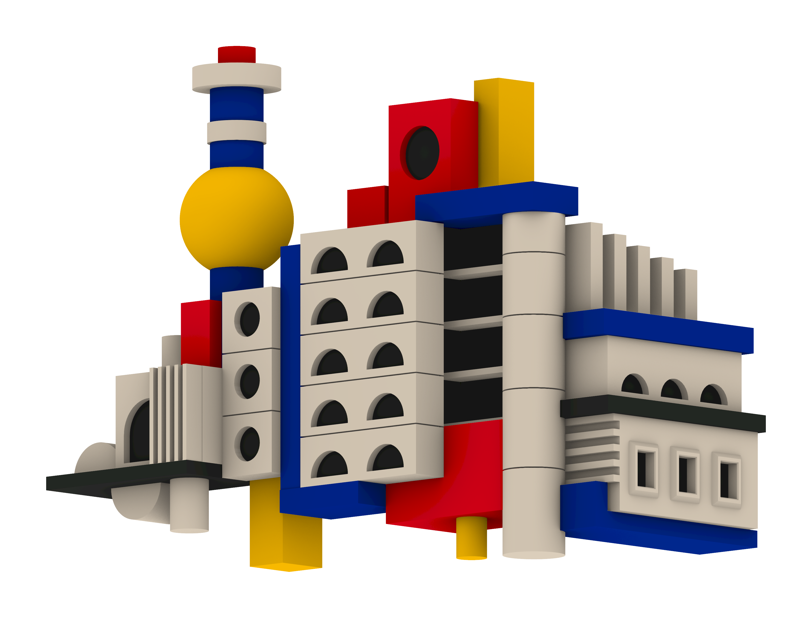
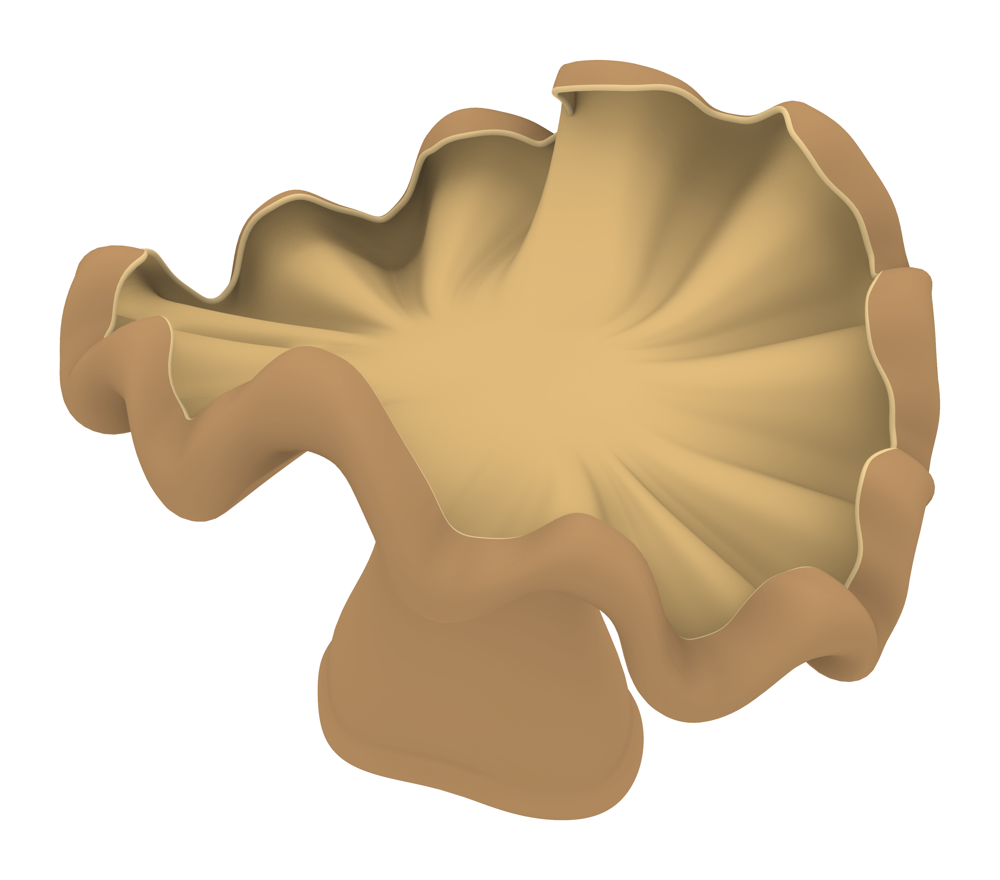
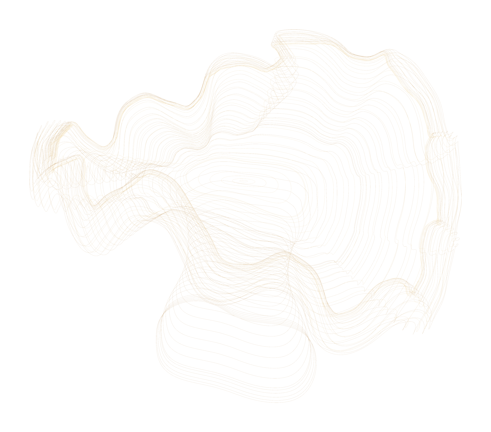
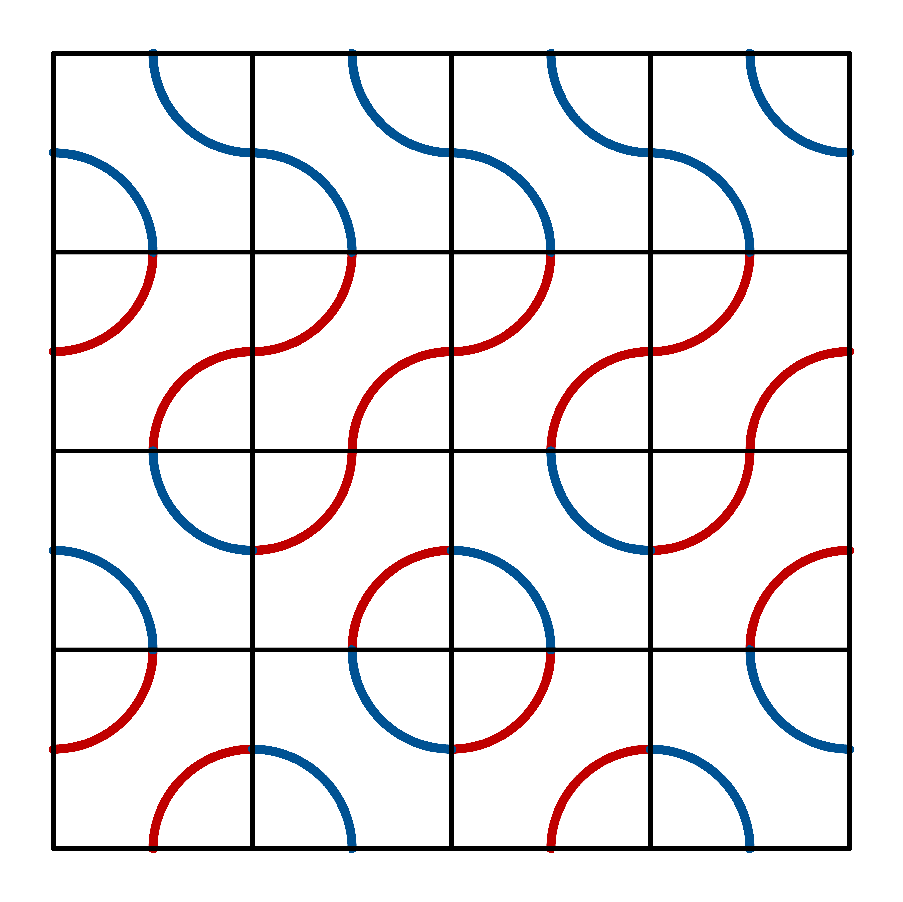

# Computational Design and Fabrication 1 (CDF1)

A teaching and design project exploring parametric geometry with **Python 3 in Rhino 8 / Grasshopper**. The assignments combine architectural composition, organic surfaces and rule-based tile patterns.

## Project overview

| Assignment | Topic | Grasshopper file | Python module |
| --- | --- | --- | --- |
| 01 | Modular Metropolis – parametric architecture | [assignment-01.gh](assignments/01/assignment-01.gh) | [assignment_01.py](src/cdf/assignment_01.py) |
| 02.1 | Sarcophyton – folded leather coral | [assignment-02-1.gh](assignments/02/assignment-02-1.gh) | [assignment_02_1.py](src/cdf/assignment_02_1.py) |
| 02.2 | Truchet tiles – variable line patterns | [assignment-02-2.gh](assignments/02/assignment-02-2.gh) | [assignment_02_2.py](src/cdf/assignment_02_2.py) |

## Getting started

1. Clone or download the repository and open **Rhino 8** with Grasshopper.
2. Add the local `src` folder to the Python module search path. Update any existing absolute paths in the GH definitions to match your local location, e.g. `C:\Projects\cdf1_teaching\src`.
3. Open the desired GH file and use **Python 3 Script**. Input names are case-sensitive; use **Item Access** for numbers and toggles.
4. Adjust the sliders and view the geometry in the Rhino model viewport. Use **Rendered** or **Raytraced** to display materials.
5. Set `c_path` in the view block to your own export folder.

The geometry functions synchronize their objects to Rhino layers. Disable GH preview for these blocks and any downstream geometry to avoid duplicate displays. For custom components, use a unique `cache_id=str(ghenv.Component.InstanceGuid)`. Unchanged inputs preserve manual object edits; `force=True` forces a rebuild of the associated objects.

## Assignment 01 · Modular Metropolis

A Bauhaus-inspired composition of arched facades, a sphere tower, fins and colored volumes. Six controls adjust proportions and repetition; **setting all values to 0** produces the reference form.

### GH block: geometry

All six inputs range from **−10 to 10**.

| Input | Effect |
| --- | --- |
| `u` | Right-wing length and window count: 1 / 3 / 7 per row at −10 / 0 / 10. |
| `v` | Diameters of the sphere tower's shaft, sphere, collars and tip. |
| `w` | Sphere-tower height; nominal factor from 0.6 to 1.4. |
| `x` | Central facade height and storey count: 2 / 5 / 9 storeys. |
| `y` | Size of the colored boxes and yellow foot cylinder; connections stay aligned. |
| `z` | Left wing: 1 / 5 / 13 fins and the size of the half-cylinders. |

**Output:** `a` contains a flat list of Breps; `out` displays messages. Editable Rhino objects are also created on five material layers under `CDF_Composition`.

Optional module settings: `scale=1.0` for overall scale, `origin=(0, 0, 0)` for translation and `seed=100` for reproducible size variations of `v` and `y`.

## Assignment 02.1 · Sarcophyton

| Surface view | Construction curves |
| --- | --- |
|  |  |

A leather coral built from spatial spline profiles and lofted surfaces. The stalk, folded crown and curled rim define the organic form, with optional small polyps. The `form` control blends between a low rosette, a compact coral and a tall stalk.

### GH block: geometry

The inputs correspond to the named arguments of `assignment_02_1.geometry(...)`. Unless otherwise noted, numeric values range from **0 to 10**.

| Input | Default | Effect |
| --- | --- | --- |
| `form` | 5 | Overall form: 0 = low rosette, 5 = compact coral, 10 = tall, narrow stalk. |
| `seed` | 1 | Reproducible asymmetry; −1,000,000 to 1,000,000, including fractional values. |
| `size` | 30 | Overall scale in model units; 0.1 to 1,000,000. |
| `height` | 5 | Crown elevation or stalk height, not total model height. |
| `width` | 5 | Scaling along world X; 5 is neutral. |
| `depth` | 5 | Scaling along world Y; 5 is neutral. |
| `radius` | 5 | Crown reach; does not change neck/stalk thickness. 5 is neutral. |
| `stem` | 0 | Lower-stalk fullness; 0 retains the baseline form. |
| `bulb` | 5 | Fullness of the central attachment region. |
| `edges` | 5 | Foot rounding and width of the shoulder transition into the crown. |
| `main_freq` | 5 | Number of primary folds; maps 0–10 to 4–20 whole-number primary lobes. |
| `main_amp` | 6 | Primary fold strength. |
| `growth_shape` | 6 | Shape of the outward-increasing fold progression. |
| `saddle_amp` | 4 | Strength of the broad saddle shape and crown inclination. |
| `z_gravity` | 3 | Vertical bending, −10 to 10: positive bends downward, negative upward. |
| `tilt` | 1 | Stalk and crown inclination. |
| `curl` | 6 | Strength of the curled-back outer margins. |
| `thickness` | 4 | Tissue thickness; remains positive even at 0. |
| `lofts` | `True` | `True`: surfaces; `False`: construction curves only. |
| `polyps` | 0 | Number of small polyps, integer 0–1500; surface mode only. |

**Output:** `geometry()` synchronizes Rhino objects under `CDF_Sarcophyton` and returns geometry grouped by part. `create_geometry()` creates the same groups without modifying the document.

Use `polyps=0` for quick iterations. The surfaces are **not closed solids**; the foot and polyp tips remain open. Extreme folds may intersect – there is no collision detection. Earlier controls such as `soften`, `level`, `rotate`, `fold_delay` and `fold_spread` are no longer part of the current interface.

## Assignment 02.2 · Truchet tiles

A square tile field centered at the origin in the XY plane. Two tile orientations connect edge midpoints with quarter circles or deformed curves. Four row patterns repeat across the field.

### GH block: geometry

Call using `assignment_02_2.geometry(q, r, s, t, u, v, w, x, y, z, p, ...)`.

| Input | Default | Effect |
| --- | --- | --- |
| `q` | 1 | Field size: 1–20 produces 1×1 to 20×20 tiles. |
| `r` | 1 | Tile size: 1–10 corresponds to 5–50 model units per side. |
| `s` | 1 | Grid print width: positive value / 10 in mm. |
| `t` | 1 | Pattern line print width: positive value / 10 in mm. |
| `u` | 0 | Curve deformation 0–10; exact quarter circles at 0. |
| `v` | 0 | Reproducible curve seed 0–10, including fractional values. |
| `w` | 1 | Pattern 1–14 for row 1. |
| `x` | 2 | Pattern 1–14 for row 2. |
| `y` | 3 | Pattern 1–14 for row 3. |
| `z` | 4 | Pattern 1–14 for row 4. |
| `p` | `False` | `True`: distinguish orientations in blue/red; `False`: both black. |

**Pattern sequence:** `B` and `R` denote the two orientations, regardless of the color setting. Words repeat from left to right; row 1 is at +Y.

| Pattern | Word | Pattern | Word |
| --- | --- | --- | --- |
| 1 | B | 8 | RRBB |
| 2 | R | 9 | BBBR |
| 3 | BR | 10 | RBBB |
| 4 | RB | 11 | BBBRR |
| 5 | BBR | 12 | RRBBB |
| 6 | RRB | 13 | BBBRRR |
| 7 | BBRR | 14 | RRRBBB |

**Output:** Curves on three Rhino layers: `CDF_Tiles::01_TileBorders`, `02_BlueTiles` and `03_RedTiles`; no GH geometry output is required. Print-width display is enabled automatically. Print widths are not model-space curve thicknesses; very wide lines may overlap visually.

## Shared GH block: view

[viewtools.py](src/cdf/viewtools.py) saves and restores the camera and exports the visible scene as a PNG. The block can be used independently of any assignment.

| Input | Meaning |
| --- | --- |
| `s_view` | Button: save the current view (`getview()`). |
| `r_view` | Button: restore the saved view (`setview()`). |
| `c_path` | Absolute export folder on your computer. |
| `c_export` | Button: export a PNG (`caputreview(...)`). |
| `c_back` | `True`: transparent background; `False`: use the background color. |
| `c_color` | GH background color when `c_back=False`. |
| `c_res` | Positive print resolution in dpi, default 300; does not change the pixel count. |
| `c_border` | Border around the cropped image, 0–10,000 whole pixels. |

**Output:** `out` displays file paths and messages. Camera data is saved as `view.json` beside the module by default; save a view before restoring it for the first time.

Export uses a **Rhino model viewport, not a layout**, fits the visible scene and crops the image with the requested border. Hidden objects remain hidden; GH preview is included where it provides extents. Capture uses three times the viewport's pixel dimensions and excludes ground-plane shadows. The camera and ground-plane state are restored afterward. Files are named `ViewCapture_YYMMDD_HHMMSS.png`; existing files are not overwritten.

## Additional resources

- [assignments/](assignments/): GH assignments and render images in their respective `renders` subfolders.
- [src/cdf/](src/cdf/): Geometry, layer, utility and viewport modules.
- [exercises/](exercises/): Exercises covering Python, geometry and algorithmic design.
- [sessions-slides/](sessions-slides/): Lecture and course slides.
- [docs/](docs/): Instructions for forking and submitting via GitHub.
