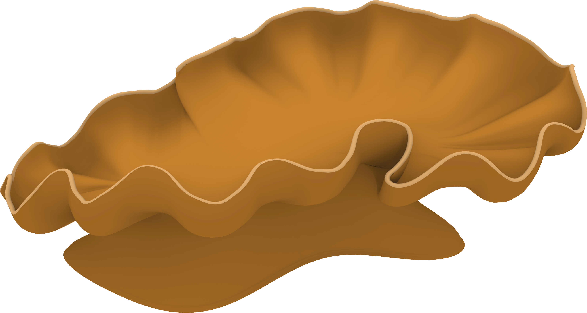
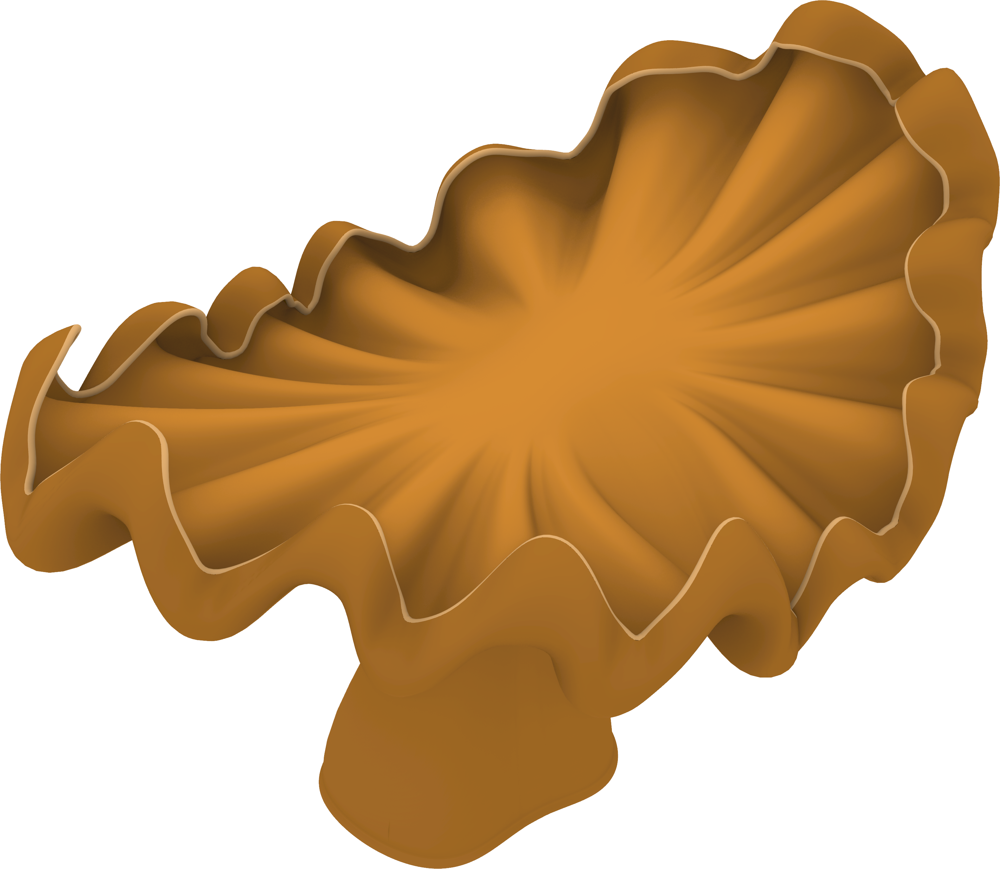
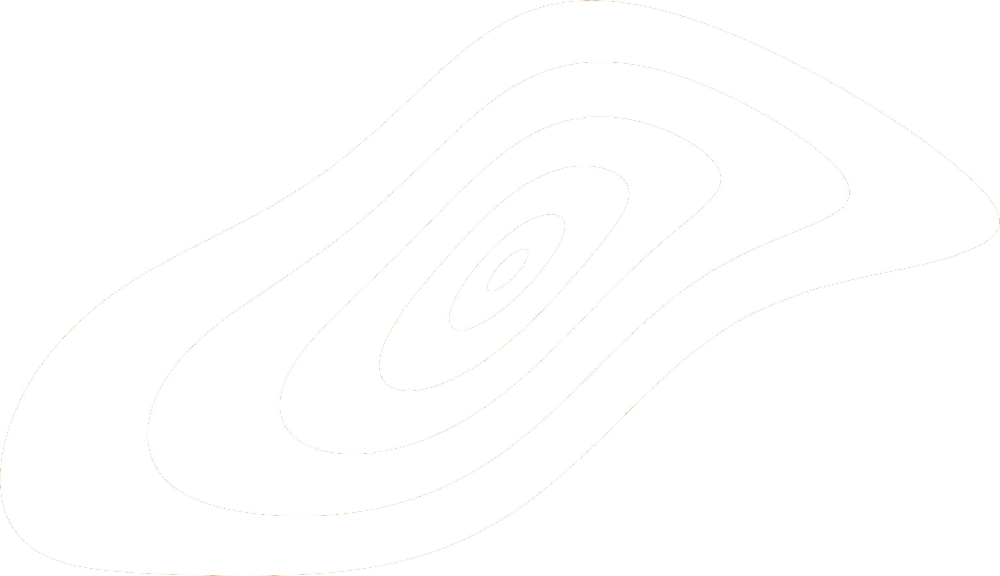
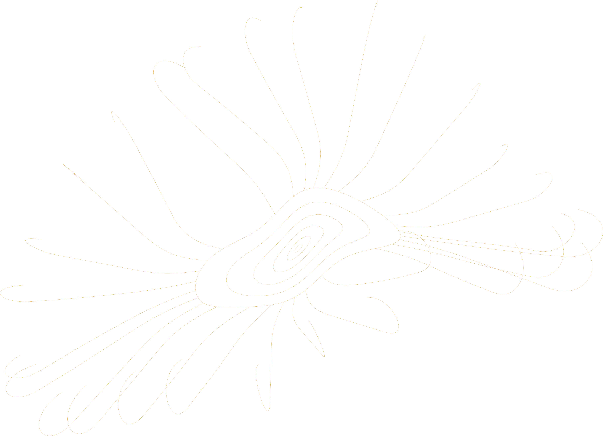
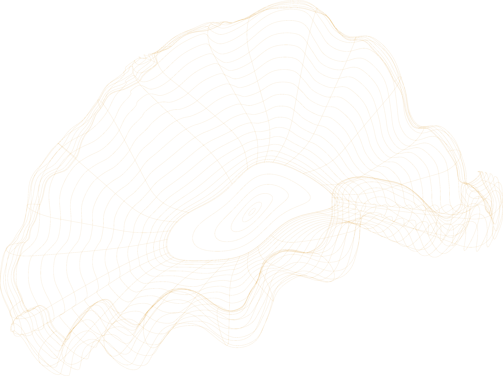
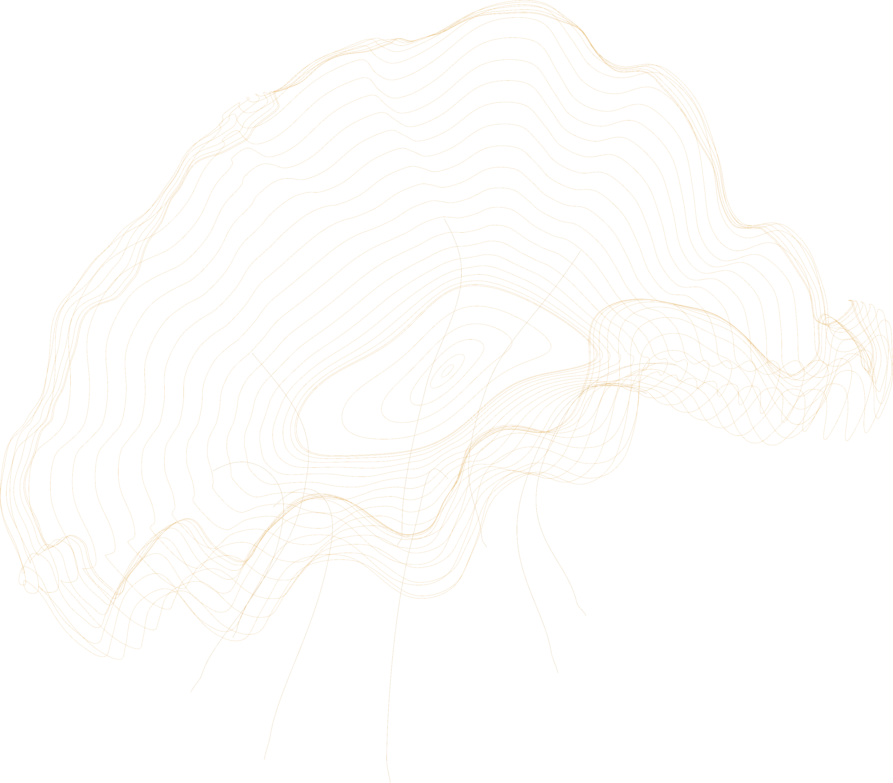
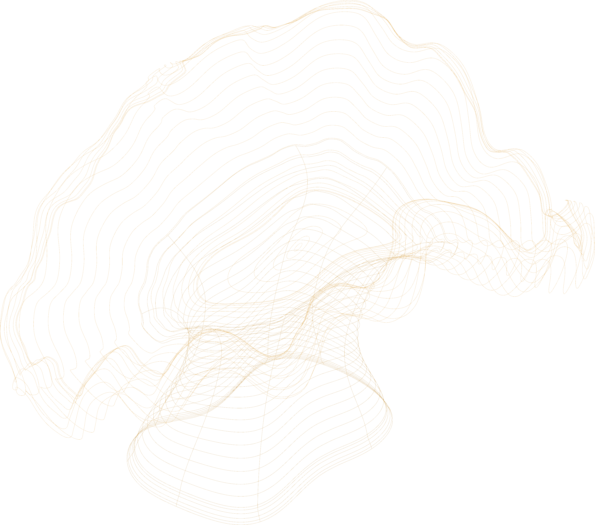
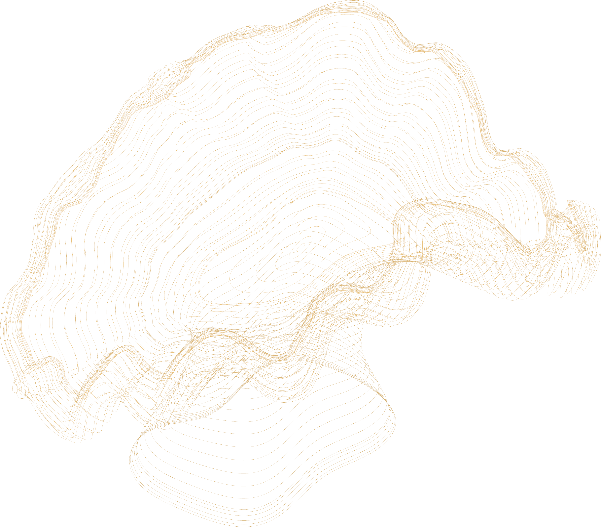
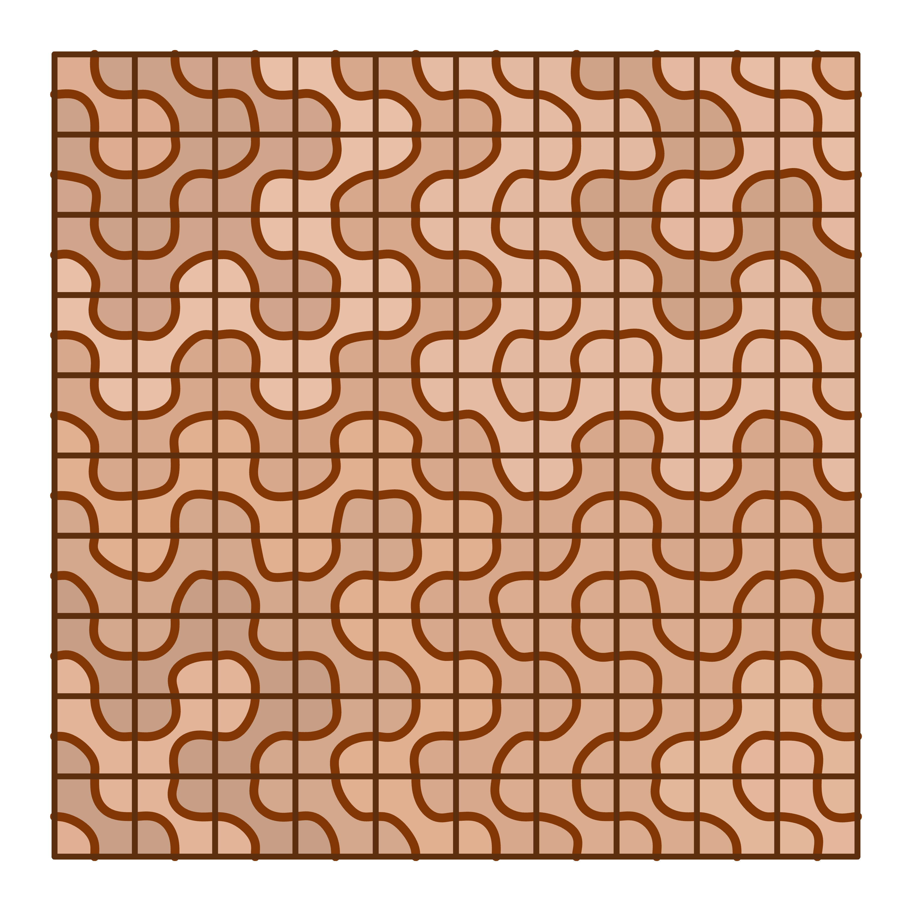
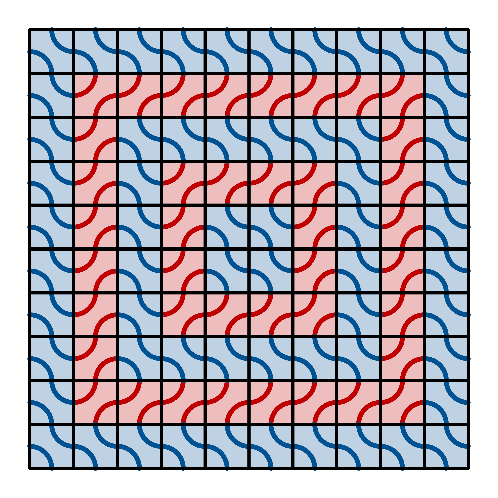

# Computational Design and Fabrication 1 (CDF1)

A teaching and design project exploring parametric geometry with **Python 3 in Rhino 8 / Grasshopper**. The assignments combine architectural composition, organic surfaces and rule-based tile patterns.

## Project overview

| Assignment | Topic | Grasshopper file | Python module |
| --- | --- | --- | --- |
| 01 | Modular Metropolis – parametric architecture | [assignment-01.gh](assignments/01/assignment-01.gh) | [assignment_01.py](src/cdf/assignment_01.py) |
| 02.1 | Sarcophyton – folded leather coral | [assignment-02-1.gh](assignments/02/assignment-02-1.gh) | [assignment_02_1.py](src/cdf/assignment_02_1.py) |
| 02.2 | Truchet tiles – variable line patterns | [assignment-02-2.gh](assignments/02/assignment-02-2.gh) | [assignment_02_2.py](src/cdf/assignment_02_2.py) |

## Getting started

1. Clone or download the repository and open **Rhino 8** with Grasshopper.
2. Add the local `src` folder to the Python module search path. Update any existing absolute paths in the GH definitions to match your local location, e.g. `C:\Projects\cdf1_teaching\src`.
3. Open the desired GH file and use **Python 3 Script**. Input names are case-sensitive; use **Item Access** for numbers and toggles.
4. Adjust the sliders and view the geometry in the Rhino model viewport. Use **Rendered** or **Raytraced** to display materials.
5. Set `c_path` in the view block to your own export folder.

The geometry functions synchronize their objects to Rhino layers. Disable GH preview for these blocks and any downstream geometry to avoid duplicate displays. For custom components, use a unique `cache_id=str(ghenv.Component.InstanceGuid)`. Unchanged inputs preserve manual object edits; `force=True` forces a rebuild of the associated objects.

## Assignment 01 · Modular Metropolis

A Bauhaus-inspired composition of arched facades, a sphere tower, fins and colored volumes. Six controls adjust proportions and repetition; **setting all values to 0** produces the reference form.

### GH block: geometry

All six inputs range from **−10 to 10**.

| Input | Effect |
| --- | --- |
| `u` | Right-wing length and window count: 1 / 3 / 7 per row at −10 / 0 / 10. |
| `v` | Diameters of the sphere tower's shaft, sphere, collars and tip. |
| `w` | Sphere-tower height; nominal factor from 0.6 to 1.4. |
| `x` | Central facade height and storey count: 2 / 5 / 9 storeys. |
| `y` | Size of the colored boxes and yellow foot cylinder; connections stay aligned. |
| `z` | Left wing: 1 / 5 / 13 fins and the size of the half-cylinders. |

**Output:** `a` contains a flat list of Breps; `out` displays messages. Editable Rhino objects are also created on five material layers under `CDF_Composition`.

Optional module settings: `scale=1.0` for overall scale, `origin=(0, 0, 0)` for translation and `seed=100` for reproducible size variations of `v` and `y`.

## Assignment 02.1 · Sarcophyton

| Low rosette | Tall stalk |
| --- | --- |
|  |  |

Spatial spline profiles are lofted into a stalk and folded crown with a curled rim. Use `form` to vary the silhouette and `stage` to inspect the curves that build the final surfaces.

### GH block: geometry

The table maps the script inputs to `assignment_02_1.geometry(...)`. Defaults are from the Python API; numeric controls range from **0 to 10** unless noted.

| GH input | Parameter | Default | Effect |
| --- | --- | --- | --- |
| `a` | `seed` | 1 | Reproducible asymmetry; −1,000,000 to 1,000,000, including fractional values. |
| `b` | `form` | 5 | 0 = low rosette, 5 = compact coral, 10 = tall, narrow stalk. |
| `c` | `radius` | 5 | Crown reach without changing neck or stalk thickness; 5 is neutral. |
| `d` | `stem` | 0 | Lower-stalk fullness; 0 retains the baseline form. |
| `e` | `edges` | 5 | Foot rounding and width of the shoulder transition. |
| `f` | `height` | 5 | Crown elevation, not total model height. |
| `g` | `width` | 5 | Scaling along world X; 5 is neutral. |
| `h` | `depth` | 5 | Scaling along world Y; 5 is neutral. |
| `i` | `bulb` | 5 | Fullness of the central attachment region. |
| `j` | `lobe_density` | 5 | Maps 0–10 to 4–20 primary lobes. |
| `k` | `lobe_strength` | 6 | Strength of the primary folds. |
| `l` | `growth_shape` | 6 | Controls how the folds develop toward the rim. |
| `m` | `saddle_amp` | 4 | Strength of the broad saddle shape and crown inclination. |
| `n` | `z_gravity` | 3 | Vertical bending from −10 to 10; positive bends down, negative up. |
| `o` | `tilt` | 1 | Stalk and crown inclination. |
| `p` | `curl` | 6 | How far the outer margins curl back. |
| `q` | `thickness` | 4 | Tissue thickness; remains positive even at 0. |
| `r` | `stage` | 9 | Integer 1–9; selects construction curves or final lofts. |
| `s` | `color` | Built-in palette | Color swatch for the crown; the other parts use lighter or darker shades. |

### Construction stages

1 shows crown core rings; 2 adds crown guides; 3 shows guides with full crown sections; 4 shows crown sections only. Stages 5, 6 and 7 add stem guides, stem guides and sections, or stem sections only, respectively. Stage 8 shows the loft profiles and stage 9 shows only the lofted surfaces.

| Stage 1 | Stage 2 | Stage 3 |
| --- | --- | --- |
|  |  |  |
| **Stage 5** | **Stage 6** | **Stage 8** |
|  |  |  |

**Output:** Rhino objects are synchronized under `CDF_Sarcophyton`. The final surface has an open base, and extreme folds can self-intersect.

## Assignment 02.2 · Truchet tiles

| Tile field | Tile pattern variant |
| --- | --- |
|  |  |

Two tile orientations connect edge midpoints with quarter circles or deformed curves on a square grid in the XY plane. Ten layout algorithms arrange the orientations, and optional fills color individual tiles or connected motif regions.

### GH block: tiles

Input names below match the labels on the connected Grasshopper sliders, color swatches and toggles. Defaults are from the Python API.

| GH input | Default | Effect |
| --- | --- | --- |
| `size` | 1 | Grid size, 1–20 tiles along each side. |
| `tile_size` | 1 | Tile size: 1–10 corresponds to 5–50 model units per side. |
| `tile_linewidth` | 1 | Grid print width in mm: positive input divided by 10. |
| `line_linewidth` | 1 | Motif print width in mm: positive input divided by 10. |
| `line_curve` | 0 | Curve deformation, 0–10; 0 gives exact quarter circles. |
| `seed` | 0 | Reproducible curve variation, 0–10; also seeds random runs and region shades. |
| `algorithm` | 1 | Layout algorithm, 1–10 (see below). |
| `tile_line` | Black | Grid line color swatch. |
| `line` | Black | Motif line color swatch. |
| `background` | Light gray | Color swatch for background fills. |
| `background` | `False` | Toggle to enable background fills. |
| `fill_patterns` | `False` | Shade connected motif regions instead of whole tiles. Requires the `background` toggle on and `pattern_distinction` off. |
| `pattern_distinction` | `False` | Use a black grid and blue/red motifs. If fills are enabled, fill whole tiles by orientation and ignore `fill_patterns`. |
| `contrast` | 4 | Fill contrast, 0–10: increases shade variation with `fill_patterns` or darkens fills with `pattern_distinction`. |
| `transparency` | 0 | Fill transparency, 0–10: 0 is opaque, 10 omits fills. Lines are unaffected. |

| Algorithm | Layout |
| --- | --- |
| 1 | Checkerboard |
| 2 | Vertical stripes |
| 3 | Horizontal stripes |
| 4 | Diagonal bands |
| 5 | Square rings |
| 6 | Single blue tiles alternating with growing red runs |
| 7 | Alternating blue/red runs of paired lengths |
| 8 | Alternating runs of increasing length |
| 9 | Alternating runs with Fibonacci lengths |
| 10 | Alternating runs with seeded random lengths |

Run-based layouts (6–10) continue across row breaks. With `fill_patterns` active, connected motifs are filled across tile boundaries rather than being cut by the grid.

**Output:** Grid lines, motif curves and optional solid hatches are synchronized under `CDF_Tiles`. Print-width display is enabled automatically; line widths are print settings, not geometric thicknesses.

## Shared GH block: view

[viewtools.py](src/cdf/viewtools.py) saves and restores the camera and exports the visible scene as a PNG. The block can be used independently of any assignment.

| Input | Meaning |
| --- | --- |
| `s_view` | Button: save the current view (`getview()`). |
| `r_view` | Button: restore the saved view (`setview()`). |
| `c_path` | Absolute export folder on your computer. |
| `c_export` | Button: export a PNG (`caputreview(...)`). |
| `c_back` | `True`: transparent background; `False`: use the background color. |
| `c_color` | GH background color when `c_back=False`. |
| `c_res` | Positive print resolution in dpi, default 300; does not change the pixel count. |
| `c_border` | Border around the cropped image, 0–10,000 whole pixels. |

**Output:** `out` displays file paths and messages. Camera data is saved as `view.json` beside the module by default; save a view before restoring it for the first time.

Export uses a **Rhino model viewport, not a layout**, fits the visible scene and crops the image with the requested border. Hidden objects remain hidden; GH preview is included where it provides extents. Capture uses three times the viewport's pixel dimensions and excludes ground-plane shadows. The camera and ground-plane state are restored afterward. Files are named `ViewCapture_YYMMDD_HHMMSS.png`; existing files are not overwritten.

## Additional resources

- [assignments/](assignments/): GH assignments and render images in their respective `renders` subfolders.
- [src/cdf/](src/cdf/): Geometry, layer, utility and viewport modules.
- [exercises/](exercises/): Exercises covering Python, geometry and algorithmic design.
- [sessions-slides/](sessions-slides/): Lecture and course slides.
- [docs/](docs/): Instructions for forking and submitting via GitHub.
